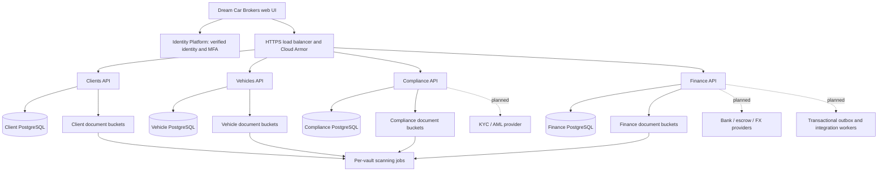

# Dream Car Brokers — GCP high-level design

**Version 0.1 · 15 October 2026 · Engineering handover**

## 1. Outcome and delivery boundary

Build a secure vehicle wealth-management platform around the supplied Dream Car Brokers frontend, with four independently permissioned vaults: compliance, client relationships, vehicles and finance. This package contains a runnable API foundation and deployment configuration, plus a target design for the larger regulated workflow. It has not been deployed to GCP, connected to a bank, or certified for production. Read the implementation matrix below before estimating remaining work.

The public frontend and its deployed JavaScript were reviewed. The private source repository, Netlify access rules and any undisclosed backend were unavailable. The source review records the evidence and migration points. The existing UI does not establish a trustworthy server-side state: its records and document uploads are browser-local; the larger-file upload path saves no file content.

The supplied DataVaults PDFs inform this design's policy, provenance and lifecycle model. They describe an EU research platform for personal data storage, sharing, analysis and monetisation. They do not specify a vehicle escrow platform, establish a compliance certification, or supply a drop-in GCP vault product. This design deliberately does not claim to implement that research system's attribute-based encryption, searchable encryption, DLT or cryptocurrency mechanisms.

## 2. Assumptions and decisions

- One GCP project per environment; a London primary region (`europe-west2`) is proposed, subject to residency requirements. Four separate Cloud SQL PostgreSQL instances provide domain isolation. A higher-assurance production variant uses a project per vault with separate administrators and service perimeters.
- One organisation is a tenant. A client is an individual or legal entity inside it, independent of the login identity. Initially one approved tenant and at most one client binding per login. Multi-organisation switching and delegated sharing require an explicit membership model in a later phase.
- End users authenticate with Identity Platform. OAuth/OIDC authenticates users and delegates access; IAM governs service and operator access to GCP. Neither replaces row-level authorisation inside the application.
- Clients access their own records; staff access their permitted domain within their organisation. There is no universal administrator role in the runtime API. Staff must present an MFA-authenticated token.
- Financial values use integer minor units and explicit ISO currency codes. Quotes, rates and fractional quantities use fixed-point decimal strings. Historical vehicles may have short chassis numbers; do not enforce a modern 17-character VIN rule globally.
- The platform records money movement; a selected banking/escrow provider holds or transfers money. A cloud bucket or a database balance is not an escrow account. Specific provider, legal structure, jurisdictions, sanctions sources and obligations remain decisions for the product/compliance team.

## 3. Logical architecture

The same API code is deployed four times with a fixed `VAULT` setting. Only that domain's routes are registered in its process. Each runtime has one IAM database user on its own database instance and bucket permissions only for its domain. It cannot read the other vaults' document buckets or log in to their databases. Database login roles never own tables and never receive DDL or DELETE grants.

The HTTPS edge routes four subdomains to four Cloud Run services through serverless network endpoint groups. Services admit load-balancer/internal ingress; direct public run.app ingress is blocked. Cloud Run invoker access is open at the service layer because end-user Identity Platform tokens are verified by the application, rather than being Cloud Run IAM invoker tokens. Cloud Armor throttles at the IP level; production also needs account-aware authentication abuse controls and recovery flows.

Cloud Run uses Direct VPC egress for private addresses; the Cloud SQL Python connector provides IAM authentication and encrypted connections to private-IP PostgreSQL. Public API/identity calls use Google's public endpoints. There is no static database password or downloaded service account key in the application. A web API key is supplied through Secret Manager to the clients/auth-facing process; restrict it to the Identity Toolkit API, configure quotas and protect authentication endpoints.

## 4. Four-vault data model

| Vault | Authoritative records | Documents | Access boundary |
|---|---|---|---|
| Compliance | KYC cases, UBO/control relationships, screening matches, AML reviews, source-of-funds evidence, review due dates, decision history | Identity, address, corporate/UBO evidence, screening reports | Compliance officers; clients see their own submission states, never internal investigation notes in the target model |
| Clients | Client entities, contacts, mandates, memberships, sharing grants, preferences | Mandates, agreements, correspondence | Relationship managers; clients see their own permitted records |
| Vehicles | Vehicle/chassis identity, ownership history, valuations, encumbrances, diagnostics and annual costs | Title, insurance, certifications, inspection, provenance, service history | Asset managers; client binding governs client access |
| Finance | Transaction intent, escrow references, payment state, provider references, FX/hedges, bank connections, ledger, reconciliation | Contracts, settlement confirmations and statements | Finance operators, distinct approvers in target workflow; clients see only permitted transaction views |

Each domain owns two private GCS buckets: quarantine and clean. Together these are four logical vaults with eight physical document buckets, plus four relational stores. GCS documents use a separate rotating Cloud KMS key per vault; PostgreSQL uses Cloud SQL's default at-rest encryption in the supplied configuration. Add SQL CMEK if required by the agreed threat model; do not describe it as already configured.

Cross-vault relationships are opaque UUID references, never duplicated identity documents. In the target design, a status projection exposes only `client_id`, eligibility result, expiry and evidence version to finance. A finance operator must not have raw AML evidence access. These projections and existence checks across stores are not implemented in the starter; staff can presently create a draft against a UUID whose existence in another vault has not been verified. Those drafts cannot settle.

The initial persistence layer uses scoped JSONB records, strongly validated at API creation, with immutable IDs, tenant/client ownership, version and timestamp. `scripts/schema.sql` is the implemented schema. The UML class model represents the fuller target domain; normalized ledger and provider data must be implemented before executing finance commands. All mutation retries use an actor-scoped idempotency key, request fingerprint and PostgreSQL transaction-level advisory lock. Successful creation and its audit entry commit atomically. Keys are retained; no automatic expiry is implemented.

## 5. Identity, permissions and sharing

Sign-up creates an Identity Platform account only. Email verification is sent using the client SDK, and an authorised operator separately approves an organisation and role using `scripts/provision_user.py`. Users cannot submit tenant IDs or roles in sign-up requests. Backend authorisation derives tenant and client from verified custom claims, never from a browser-supplied tenant header. Tokens are verified for signature, issuer, audience, expiration, revocation and disabled-user state through the Admin SDK. Staff MFA is checked on every authenticated request.

Basic `/auth/sign-in` supports password sign-in. A staff MFA challenge uses the Identity Platform client SDK's resolver; this starter does not proxy MFA enrollment/challenges, email verification, token renewal or password reset. The browser adapter accepts a token callback so SDK-managed refresh is supported. Configure in-memory persistence and use SDK sign-out to clear a browser session. Local sign-out does not revoke an already issued bearer token; an authorised operator revokes sessions for suspected compromise and membership changes. Runtime services receive identity read permissions only, avoiding user-update/custom-claim escalation privileges.

| Role | Clients vault | Vehicles vault | Compliance vault | Finance vault |
|---|---|---|---|---|
| Client | Own read/doc upload | Own read/doc upload | Own case create/read/doc upload | Own draft read/doc upload |
| Relationship manager | Tenant read/create/doc upload | None | None | None |
| Asset manager | None | Tenant read/create/doc upload | None | None |
| Compliance officer | None | None | Tenant case read/create/doc upload | None |
| Finance operator | None | None | None | Tenant draft read/create/doc upload |

A staff member needing more than one domain needs an explicit approved role set. The provisioning script deliberately grants one role at a time. Production membership administration needs a dedicated privileged service with dual approval for finance/compliance roles; do not expose the operator script as a public endpoint.

PostgreSQL row-level security restricts tenant and client visibility, using transaction-local scope values to prevent connection-pool leakage. This is defence in depth against missing application filters, not a defence against a fully compromised runtime that can set its own SQL session values. Domain IAM isolation limits that compromise to one vault. The target adds purpose-limited/time-limited sharing grants, legal basis and grant revocation. No externally shared URLs or consent management API is implemented. Keeping downloads behind the API avoids issuing document bearer links that outlive access revocation.

## 6. Processes and state machines

### Onboarding and KYC

1. User signs up; verifies email; staff enroll MFA. An operator approves tenant/client membership.
2. Relationship manager creates the client entity. Corporate clients need UBO/control structure capture in the target schema.
3. Client or compliance officer creates a KYC case and uploads evidence to that case.
4. An authorised scan job validates stored generation, file type, checksum and current malware definitions. It marks the record clean only after promotion to the clean bucket succeeds.
5. The planned screening integration requests identity/sanctions/PEP checks, records provider evidence versions and routes possible matches to compliance staff. No automatic clearance is derived from merely uploading a document.
6. Planned manual review makes an auditable decision with expiry and re-screening schedule. New sanctions matches or expired KYC block settlement eligibility.

Starter case state is `draft` only. Target case states: `draft → submitted → screening → review → approved / rejected`; approved cases can become `expired` or `suspended`. Only a compliance reviewer can decide; a client cannot post an approval result.

### Vehicle registration and document lifecycle

Asset manager creates the asset with client UUID, chassis number, purchase/valuation currencies and title status. Client name is a view field derived from the client vault. Registered title assertions remain unverified until the relevant evidence/review is complete. Updates, valuations and ownership transfers require separate versioned commands in a later phase.

Document metadata starts `awaiting_upload`. Authenticated raw-byte PUT is limited to 20 MiB and checks declared MIME type, actual signature, length and SHA-256. Bytes go to a create-only quarantine object identified by tenant/document UUID. The database captures its exact generation and changes state to `quarantined`. A failed DB commit after a successful object write can be reconciled by retrying the same bytes; mismatching stored bytes fail closed.

The scanner uses a separate identity, reads that exact quarantined generation and rejects stale/unavailable antivirus definitions. A successful scan promotes to a create-only clean object; the committed clean generation is pinned for downloads. Infection produces `rejected`; scanner errors leave the object quarantined. Read access alone cannot submit clean status through an API. The job is manually invoked in the supplied deployment; automatic event delivery, backpressure, pending-job dispatch and dead-letter handling are planned work. Unscanned documents remain unavailable rather than being silently released.

No document delete endpoint exists. The target deletion flow checks legal holds, approved retention schedules, sharing grants and ownership, then removes all relevant object versions and derived copies with auditable completion. With bucket versioning enabled, deleting the latest object alone is insufficient. Retention duration must be agreed per record type and jurisdiction before irreversible bucket locks are enabled.

### Transactions, escrow, payments and FX — target workflow

A transaction starts as a draft with asset, parties, direction and money. Eligibility must validate both parties, beneficial owners, title, amount limits, sanctions and evidence freshness. Create a provider escrow reference only after eligible parties and an agreed contract exist. Accept funding only from authenticated provider events and reconciliation, never from a browser flag or redirect.

Suggested states: `draft → eligibility_pending → eligible → escrow_open → funding_pending → funded → release_pending → settled`. Branches include `blocked`, `cancelled`, `disputed` and `refunded`; all monetary reversals are compensating ledger entries. Release requires a maker and a different approver, current compliance/asset evidence, verified beneficiary, escrow contract conditions, MFA and provider acceptance. Provider acknowledgement means `processing`, not `settled`.

FX quotes carry base/quote currencies, source/target amounts, decimal rate, fees, expiry and provider reference. Booking requires an unexpired quote and a stable idempotency key. A hedge has instrument, notional, currency pair, maturity, counterparty, suitability/approval reference and remaining exposure. A quote is not a booked hedge. Payment tracking stores accepted/processing/settled/failed/reversed transitions, provider timestamps and a reconciled bank reference.

Bank connections use the chosen provider's OAuth authorization-code flow with state and PKCE where supported; request only agreed account/payment scopes. Callback codes exchange server-side; provider refresh tokens live in the finance vault using envelope encryption/Secret Manager references, never in the browser or logs. Payment initiation and beneficiary changes require separate approval and provider-specific strong authentication where applicable.

The target ledger is double-entry and append-only, balances each currency independently, and never uses floating point. FX uses explicit clearing legs and rate references rather than summing different currencies. Balance changes, outbox commands and transaction states commit in the same database transaction. Webhooks verify provider-specific signatures over raw bytes, timestamp/replay windows and key rotation; a unique `(provider,event_id)` inbox suppresses duplicates. Persist before acknowledging, accept out-of-order events through guarded transitions and reconcile independently to provider statements. This delivers at-least-once processing with idempotent effects; it does not promise exactly-once delivery.

`api-finance-target.json` specifies these planned integration endpoints. The runnable finance service creates drafts and returns 501 for submit: no bank, escrow or FX calls are executed.

## 7. Operations and non-functional targets

Proposed targets, not measured guarantees: 99.9% monthly API availability; metadata p95 below 500 ms excluding provider calls; 20 MiB uploads; RPO no more than 15 minutes and RTO no more than four hours, subject to restore exercises. Cloud SQL is regional HA with automated backups and PITR enabled. Regional HA does not cover total regional loss; a secondary-region replica and cross-region object backup require residency approval and implementation before a regional DR commitment.

Structured audit captures tenant, actor, action, resource ID and time without document contents or account numbers. API mutations and audit inserts share a DB transaction. Runtime cannot update/delete audit rows. This is not complete tamper-proof audit: database owners and project administrators retain control. Export audit and GCP Data Access logs to a separately administered immutable sink, enable appropriate Data Access logs, alert on unusual downloads and access failures, and restrict break-glass access before production. Failed authentication/authorization audit and security monitoring still need integration.

Production readiness includes restore tests, alert routing, credential rotation, certificate/DNS checks, rate-limit tuning, account abuse protection, vulnerability scanning, dependency review, SAST, penetration testing and an incident runbook. Never log passwords, tokens, file contents or webhook bodies. TLS ingress, exact CORS origin, no-store responses, content-type protection and private bucket access are implemented. Add CSP and secure static hosting headers when migrating the frontend. A billing budget and quotas should be set before provisioning: four regional HA SQL instances are a substantial fixed cost. No price estimate is asserted without a workload and current quote.

## 8. Implementation matrix and delivery phases

| Capability | Included code | Remaining before production |
|---|---|---|
| Password sign-up/sign-in | REST proxy on clients service | SDK verification/recovery/refresh/MFA UI, account migration, abuse protection |
| Approved identity and roles | Verified/revocation-checked tokens; staff MFA; operator provisioning | Privileged membership workflow, invitation audit, multi-tenant switching |
| Four isolated vaults | Four Cloud Run/SQL instances, per-domain identities/buckets/keys | Live GCP validation, stronger project/admin separation if required |
| Client/asset registration | Typed create, get, paginated list and retry protection | Cross-vault existence validation, edit/archive, client contact/UBO models |
| KYC | Draft case and evidence upload/read | Screening provider, decision workflow, internal/external response redaction |
| Documents | Metadata, upload, scan job, clean-only downloads | Automatic scan dispatch/retries/alerts, retention/deletion, load/security testing |
| Finance | Transaction drafts; execution fails closed | Ledger, eligibility, escrow, payment, FX/hedge and bank adapters, maker/checker |
| Frontend integration | API client module and migration map | Apply migration to the frontend source, deploy new login/onboarding screens |
| Infrastructure | Terraform resources, edge TLS/Armor, IAM, private SQL, HA/PITR | Authenticated plan/apply, migrations, DNS/secret setup, restore drills |
| Audit | Transactional append-only-for-runtime audit table | Immutable independent export, denied-access logs, monitoring and response |

Recommended milestones: (1) recover the source repository and confirm tenancy/residency/provider decisions; (2) deploy an isolated development environment and migrate identity/client/asset/document flows; (3) implement compliance screening and human review; (4) build and certify ledger/escrow/bank/FX integrations in provider sandboxes; (5) complete recovery, security and operational acceptance; (6) controlled production migration. Estimates depend strongly on provider selection and their onboarding requirements.

## 9. Source traceability

- [Reviewed frontend](https://vermillion-speculoos-720254.netlify.app/index.html): deployed HTML/JS only, captured 15 October 2026; hashes in `frontend-source-manifest.json`.
- [DataVaults D1.2 — Core Semantic Data Model](https://drive.google.com/file/d/1d92bk8ghc6jd6BorRmE9WCuzSw_na6Qt/view): sections 2.1 and 3 inform catalogue/distribution metadata, policy association and lifecycle separation. The proposed UUID document metadata can later export a DCAT/ODRL profile; it does not currently implement RDF/ODRL evaluation.
- [DataVaults D1.3 — MVP and Usage Scenarios](https://drive.google.com/file/d/1KeyEa5TgjNQInDv8j3u28shTWcPWraTF/view): data acquisition, storage/sharing and revocation/deletion operations inform lifecycle design. Research-specific advanced cryptography/DLT remains out of scope.
- [DataVaults D5.1 — User Stories and Non-Functional Requirements](https://drive.google.com/file/d/1LkDqhiQdOe_1vgjncVz3D93aKwbe20vY/view): sections 5.2.3, 5.2.10, 6.1.10 and 6.2 inform controlled sharing, policy decisions and non-functional acceptance. This is a domain adaptation, not a claim of conformance to every research requirement.
- [Identity Platform end-user authentication on Cloud Run](https://docs.cloud.google.com/run/docs/tutorials/identity-platform), [ID token verification](https://firebase.google.com/docs/auth/admin/verify-id-tokens), [sign-up REST API](https://docs.cloud.google.com/identity-platform/docs/reference/rest/v1/accounts/signUp), [password sign-in API](https://docs.cloud.google.com/identity-platform/docs/reference/rest/v1/accounts/signInWithPassword).
- [Cloud SQL IAM login](https://docs.cloud.google.com/sql/docs/postgres/iam-logins), [Cloud Run Direct VPC](https://docs.cloud.google.com/run/docs/configuring/vpc-direct-vpc), [GCS customer-managed keys](https://docs.cloud.google.com/storage/docs/encryption/customer-managed-keys). These sources ground service capability choices; the local validation report states what was actually tested.
